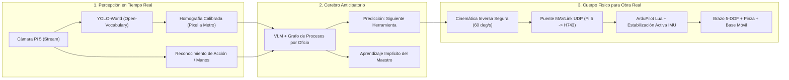
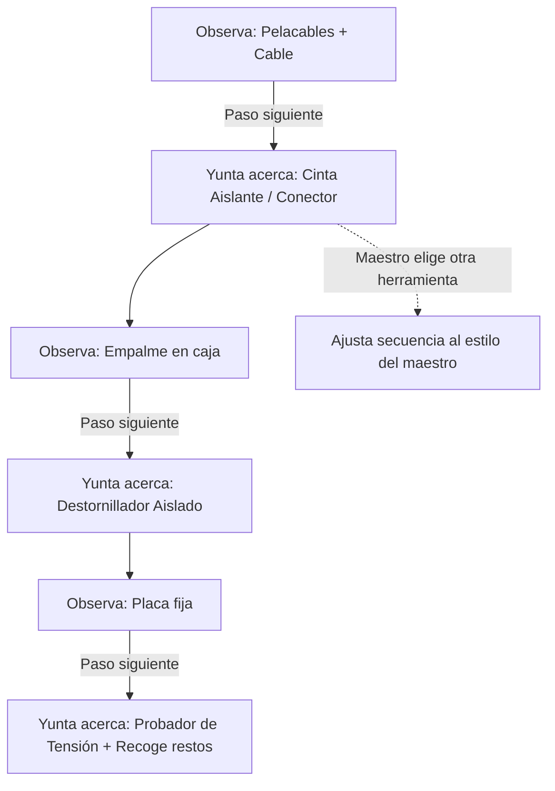

# Pitch Platanus Hack 26 — Yunta (Edición Puro Impacto, Calibrado para la CChC)

> **Enfoque 100% Impacto + Tecnología (cero negocio):** Todo dato está auditado para resistir el escrutinio directo de la **Cámara Chilena de la Construcción (CChC)**, usando su propio lenguaje técnico (*Trabajo Productivo / Contributorio / No Contributorio*) y citando estudios co-elaborados por la propia CChC, su OTIC y la Mutual de Seguridad.

---

## 1. La Tesis Central

> **La construcción es el pilar físico de la civilización — pero lleva más de 20 años congelada en el terreno.**  
> El cuello de botella hoy no son solo las grúas ni el hormigón: más de la mitad de una obra ocurre adentro (electricidad, gasfitería, pintura, terminaciones), donde maestros cada vez mayores pierden horas en traslados, búsquedas y sobreesfuerzo físico.  
> Ningún maestro debería trabajar solo: creamos **Yunta**, un ayudante de obra robótico y anticipatorio. Un rover con brazo estabilizado e IA que observa lo que haces como una **instrumentista quirúrgica en pabellón**, entiende el proceso constructivo y se adelanta para pasarte la siguiente herramienta o recoger lo que se cae **antes de que lo pidas**.

---

## 2. Auditoría de la Cifra de Productividad en Terreno (Cómo decirla frente a la CChC)

**Qué NO decir frente a la CChC:** Evitar la frase *"el maestro solo trabaja el 30% del día y el otro 70% se pierde"*. Es imprecisa (mezcla tareas de apoyo necesarias con tiempos muertos) y suena injusta con los trabajadores.

### Cómo se mide oficialmente en construcción (CDT-CChC / GEPUC / CII)
Bajo la metodología *Work Sampling / Carta Balance* (Lean Construction), la jornada se divide en **tres categorías**:

1. **Trabajo Productivo (TP):** Ejecutar directamente la tarea física que agrega valor (cablear, instalar un enchufe, unir una cañería, pintar, levantar tabique).
2. **Trabajo Contributorio (TC):** Tareas de apoyo *necesarias* pero que no avanzan la obra directamente (medir, leer planos, recibir instrucciones, **trasladar materiales, preparar y acercar herramientas**, ordenar).
3. **Trabajo No Contributorio (TNC):** Pérdidas puras (esperar materiales o herramientas, caminar con las manos vacías, detenciones por falta de insumos).

### Las cifras exactas y defendibles
* **Benchmark internacional (Construction Industry Institute — CII):** El trabajo productivo directo (*Direct Work / Wrench Time*) suele ubicarse entre **30% y 45%** de la jornada. Del resto, **15% a 20%** se va en **desplazamientos/traslados** y **10% a 15%+** en **manejo de materiales y esperas**.
* **Mediciones en edificación en Chile (Lean Construction / CDT-GEPUC):** El **TP** suele moverse entre **30% y 48%** (típicamente **menos de la mitad de la jornada**), mientras **TC + TNC** supera fácilmente el 50%.
* **La frase exacta para el escenario:**
  > *"En obra, el tiempo se divide en Trabajo Productivo, Contributorio y No Contributorio. Tanto estudios internacionales del Construction Industry Institute como mediciones en edificación en Chile muestran que **menos de la mitad de la jornada —muchas veces entre un 30% y un 45%— es trabajo productivo directo**. Y no es culpa del maestro: **entre un 15% y un 25% de su día se va simplemente en trasladarse, buscar herramientas, acarrear insumos y esperar**."*

---

## 3. Banco de Cifras Blindadas (Incluyendo Estudios Propios de la CChC)

### Pilar 1 — Eficiencia y Velocidad de la Civilización
| Dato | Cifra exacta | Fuente oficial | Por qué golpea fuerte |
| :--- | :--- | :--- | :--- |
| Peso global de la construcción | **13% del PIB mundial** | McKinsey Global Institute | Es literalmente la base material de la civilización. |
| Estancamiento de 20+ años | Productividad construcción: **0,4%–1% anual** vs. manufactura **~3% anual** | McKinsey Global Institute | Dos décadas congelada mientras el resto de las industrias se automatizó. |
| Última gran revolución en manos del maestro | Herramientas inalámbricas de litio (**2005**, Milwaukee V28 / Bosch IXO) | Historia industrial | **21 años** sin un salto real en cómo trabaja el maestro día a día. |
| Brecha de productividad en Chile vs. OCDE | Brecha de **52 puntos porcentuales** (penúltimo en la OCDE). En edificación: **0,24 vs. 0,37 m²/persona-día** (**53% de brecha**). **Con los mismos recursos, Italia levanta un edificio de 19 pisos donde Chile levanta 13.** | **Comisión Nacional de Productividad (CNP) + CChC + Matrix Consulting (2020)** | **Estudio propio de la CChC.** La imagen de *19 pisos vs. 13 pisos* es imposible de olvidar. |
| Urgencia social en Chile | Déficit cercano a **935.000–980.000 viviendas** y **>120.000 familias** en campamentos | **CChC** (*Balance de Vivienda*) | Construir más rápido resuelve una crisis humana concreta. |
| Obra gruesa vs. Interior (MEP + Terminaciones) | Obra gruesa (estructura) = **20%–35%** del costo y **20%–30%** del tiempo. Instalaciones **MEP** (electricidad, gasfitería, clima) + **terminaciones** (pintura, tabiquería, pisos) = **50%–65%** del costo y **más de la mitad del cronograma**. | Benchmarks de edificación | Muestra dónde está el cuello de botella olvidado por la maquinaria pesada. |
| Ocupación del tiempo en terreno | **30%–45%** Trabajo Productivo directo (*CII* / mediciones en edificación); **15%–25%** en traslados, búsqueda y manejo de herramientas/materiales. | **CII** / Lean Construction (TP, TC, TNC) | Cifra rigurosa y respetuosa con el oficio. |

### Pilar 2 — Dignidad Humana, Envejecimiento y Seguridad
| Dato | Cifra exacta | Fuente oficial | Por qué golpea fuerte |
| :--- | :--- | :--- | :--- |
| Envejecimiento en la construcción chilena | **34,6%** de los trabajadores tiene **más de 50 años** (en 2010 era 26,6%). Jóvenes de 15–29 años cayeron al **15,4%** (desde 22,5% en 2010). | **CIEDESS + OTIC CChC (2024)** (*"Reconversión laboral de mayores de 50 años en la construcción"*) | **Dato oficial del propio OTIC de la CChC.** Además advierte la crisis del modelo tradicional de **"maestro y aprendiz"**. |
| El futuro demográfico ya visible (Japón) | **~35%** de los trabajadores tiene **más de 55 años** y solo **10%–11%** son menores de 29. | Ministerio de Infraestructura de Japón (MLIT) | Confirma que es una megatendencia mundial irreversible. |
| Caídas y accidentes graves en Chile | Las caídas representan **26%–35%** del total de accidentes laborales; las **caídas desde altura** explican cerca del **27% de los accidentes graves** y **~38% de las muertes** por caídas. En EE.UU., **1 de cada 5 caídas fatales** en obra involucra una escalera. | **Mutual de Seguridad CChC** / OSHA-CPWR | Conecta directo con Yunta: evitar que el maestro baje y suba de la escalera 30 veces al día por herramientas o insumos olvidados. |
| Sobreesfuerzo y trastornos musculoesqueléticos | Entre las principales enfermedades profesionales del sector; en 2026 entró en vigencia el **Protocolo TMERT V3** del MINSAL (vigilado por la Mutual CChC) por carga física, movimientos repetitivos y posturas forzadas. | **MINSAL / SUSESO / Mutual de Seguridad CChC** | Muestra conocimiento actual del contexto chileno de seguridad laboral. |

---

## 4. El Corazón de Yunta: IA Anticipatoria ("La Instrumentista")

El propio estudio del **OTIC CChC + CIEDESS** alerta que el envejecimiento está rompiendo la cadena tradicional de **"maestro y aprendiz"**.  
**Yunta** no pretende reemplazar al maestro: es su compañero de faena que cuida su salud hoy, elimina viajes innecesarios y **aprende el oficio observándolo**.

### Por qué "Anticipatorio" (y NO por comandos de voz o pantalla)
En una obra real hay **90 decibeles de ruido** (rotomartillos, esmeriles, sierras), polvo y las dos manos ocupadas. Si un maestro tiene que sacar una tablet o gritarle comandos a un robot, tarda más que ir a buscar la herramienta solo.

Yunta funciona como una **instrumentista quirúrgica en pabellón**:
1. **Observación continua:** la cámara ve qué herramienta sostienen las manos del maestro y sobre qué material trabaja.
2. **Comprensión del proceso constructivo:** la IA mapea esa acción a un **grafo de secuencia del oficio** (electricidad, gasfitería, tabiquería, pintura).
3. **Acción proactiva sin interrupción:** antes de que el maestro termine el paso actual, Yunta se posiciona en la zona de entrega con la herramienta o insumo siguiente listo, y recoge lo que ya terminó de usar o lo que cayó al suelo.

### Ejemplos concretos en 4 oficios internos

| Oficio | Qué observa la cámara | Qué anticipa la IA | Qué hace Yunta |
| :--- | :--- | :--- | :--- |
| **Electricidad** | Maestro toma pelacables y pela dos conductores. | Empalme y aislación inmediata. | Acerca **cinta aislante (huincha aisladora) / conector Wago**; luego prepara el **destornillador aislado** y el **probador de tensión**. |
| **Gasfitería** | Corta tubería PVC con cortatubos. | Limpieza, pegado y unión. | Presenta **lija + adhesivo PVC + codo/copla**, y recoge el cortatubos del suelo. |
| **Tabiquería (Volcanita)** | Posiciona plancha y levanta atornillador. | Fijación secuencial. | Mantiene la **bandeja de tornillos** a la altura de la mano y recoge herramientas o puntas caídas. |
| **Pintura y Terminaciones** | Lija unión con masilla en muro. | Limpieza de polvo y enmascarado. | Acerca **escobilla/paño** y prepara **cinta de enmascarar (*masking tape*)** sin que baje de la escalera. |

---

## 5. Arquitectura Técnica (Lo Construido en 36 Horas + Visión)

### Grafo de Proceso (Ejemplo Electricista)

### Integración real del equipo (`team-41`)
1. **Diseño mecánico e impresión 3D (`solidcraft_import/`, `toolhead_13mm/`, `print_jobs/`):** brazo compacto de 5 DOF + pinza (4× MG995 + 2× SG90), chasis móvil y cabezal sujetador expandible de 13 mm, listos para manufactura en PLA.
2. **Simulación física y control aprendido (`simulation/`):** simulador en **MuJoCo** + Gymnasium con auditoría física y currículum entrenado de alcance, ruteo y acople de herramientas.
3. **Estabilización activa por IMU en hardware real:** controladora **Matek H743** con ArduPilot + script Lua que compensa en vivo **Roll, Pitch y Yaw** para pisos irregulares, cables y desniveles de obra, con límite de velocidad seguro (`60°/s`).
4. **Visión *open-vocabulary* y puente inalámbrico:** **Raspberry Pi 5** + stream de cámara + puente MAVLink UDP conectado a **YOLO-World** y calibración por homografía pixel-a-metro para reconocer herramientas nuevas sin reentrenar desde cero.

---

## 6. Estructura de Slides (7 Slides — Puro Impacto, Cero Relleno)

1. **Slide 1 — Portada:** **Yunta** + foto del rover + frase: *"El ayudante de obra que sabe lo que viene antes de que lo pidas."*
2. **Slide 2 — El Pilar Congelado:** **13% del PIB mundial** | Último gran salto en terreno: **2005 (herramientas de litio)** | Dato CNP + CChC: **19 pisos (OCDE) vs. 13 pisos (Chile)** con los mismos recursos + casi **1 millón de viviendas** de déficit.
3. **Slide 3 — El Cuello de Botella Olvidado:** Obra gruesa (grúas) = ~1/3 vs. **Interior (electricidad, gasfitería, pintura, terminaciones) = >50% del tiempo y costo**. Barra de ocupación de jornada: **TP (30%–45%) | TC | TNC** → **15%–25% se va en traslados, búsquedas y acarreo**.
4. **Slide 4 — La Crisis Humana (Datos OTIC CChC + Mutual):** **34,6% mayores de 50 años** | **15,4% jóvenes** | **Caídas = 27% accidentes graves y ~38% muertes por caída** + Protocolo TMERT. Frase: *"No reemplazamos al maestro: cuidamos su cuerpo y preservamos su oficio."*
5. **Slide 5 — La Solución: Yunta (IA Anticipatoria):** Diagrama visual en 3 pasos: *Observa tus manos → Entiende el proceso constructivo → Se adelanta con la herramienta* (ejemplo visual: pelacables → cinta aislante).
6. **Slide 6 — Demo en Vivo:** *(Slide limpia: "DEMO EN VIVO — YUNTA" — toda la atención en el robot).*
7. **Slide 7 — Arquitectura (36h) + Visión de Impacto:** CAD + MuJoCo + Pi 5 + YOLO-World + Matek H743 con estabilización IMU + visión: liberar al trabajador del desgaste físico repetitivo, volver el oficio atractivo para nuevas generaciones y preservar el conocimiento de nuestros maestros en *Physical AI*.

---

## 7. Guion Cronometrado de 3:00 Minutos (100% Impacto + Tech, Cero Negocio)

*(Sugerido en 2 voces: **Speaker 1** = Impacto y Problema; **Speaker 2** = Ingeniería y Demo; **Speaker 1** = Cierre).*

* **[0:00 – 0:25] Hook — El pilar congelado (Speaker 1)**
  > "La construcción es el pilar físico de la civilización: representa el **13% del PIB mundial**. Viviendas, hospitales, energía, todo depende de qué tan rápido construimos. Sin embargo, mientras la manufactura se automatizó y creció al 3% anual, la construcción lleva más de 20 años estancada bajo el 1%. El último gran salto en las manos de un maestro fueron las herramientas inalámbricas de litio… en **2005**. En Chile lo sabemos bien: según el estudio de la **CNP y la Cámara Chilena de la Construcción**, con los mismos recursos que un país referente de la OCDE levanta un edificio de **19 pisos**, acá levantamos **13**."

* **[0:25 – 0:55] El cuello de botella olvidado y TP/TC/TNC (Speaker 1)**
  > "Cuando pensamos en modernizar la obra, imaginamos grúas y hormigón. Pero esa obra gruesa es apenas un tercio del proyecto. **Más de la mitad del tiempo y del costo está adentro**: electricidad, gasfitería, pintura, terminaciones. Ahí no caben máquinas gigantes; es trabajo 100% artesanal. Y si miramos cómo se distribuye la jornada entre Trabajo Productivo, Contributorio y No Contributorio, estudios internacionales y en edificación muestran que **menos de la mitad del turno —muchas veces entre un 30% y un 45%— es trabajo productivo directo**. No porque el maestro sea lento, sino porque **entre un 15% y un 25% de su día se va trasladándose, buscando herramientas y acarreando materiales**."

* **[0:55 – 1:25] La crisis demográfica y humana (Speaker 1)**
  > "Y a eso se suma una crisis humana urgente. Según el estudio de **CIEDESS y el OTIC de la CChC**, el **34,6% de los trabajadores de la construcción en Chile ya supera los 50 años**, y los jóvenes cayeron al **15,4%** — rompiendo el modelo tradicional de maestro y aprendiz. Es un trabajo físicamente durísimo: las lesiones musculoesqueléticas desgastan espalda y rodillas, y las caídas desde altura lideran los accidentes graves y fatales. ¿Cuántas veces al día baja y sube un electricista de una escalera solo porque se le cayó un alicate o le faltó cinta aislante? Lo más valioso en obra son los **30 años de criterio en la cabeza del maestro**, no su espalda agachándose 150 veces al día."

* **[1:25 – 1:55] La Solución: Yunta (Speaker 1)**
  > "Ningún maestro debería romperse la espalda solo. Por eso creamos **Yunta**: un brazo robótico móvil con IA que actúa como un **ayudante de obra anticipatorio**. En una obra con 90 decibeles de ruido, un robot al que tienes que darle órdenes por voz o pantalla estorba. Yunta funciona como una **instrumentista quirúrgica en pabellón**: su cámara observa continuamente lo que estás haciendo, **entiende el proceso constructivo** y se adelanta al siguiente paso. Si te ve pelando cables, ya está listo acercándote la cinta aislante. Si terminaste o se te cayó una herramienta al suelo, la recoge por ti. Y funciona igual en gasfitería, carpintería o pintura."

* **[1:55 – 2:38] Demo en Vivo + Ingeniería (Speaker 2)**
  > "En estas 36 horas diseñamos, simulamos en **MuJoCo** y construimos el primer prototipo físico de Yunta: un brazo de 5 ejes impreso en 3D sobre una base móvil, con **Raspberry Pi 5**, visión *open-vocabulary* con **YOLO-World** —capaz de identificar herramientas nuevas sin reentrenar desde cero— y una **Matek H743 con estabilización activa por IMU**.
  > *(Demo A — Estabilización, 10 seg):* En obra real el suelo no es perfecto: hay cables, polvo y desniveles. Miren cómo al inclinar la base, la IMU compensa en tiempo real para mantener la pinza estable y segura.
  > *(Demo B — Visión + Anticipación, 20 seg):* Y con visión en tiempo real, Yunta detecta lo que está ocurriendo, traduce la escena a coordenadas métricas mediante homografía y mueve el brazo suavemente para acercar exactamente la herramienta que sigue."

* **[2:38 – 3:00] Visión de Impacto y Cierre (Speaker 1)**
  > "Hoy convertimos tiempos de traslado, búsqueda y desgaste físico en tiempo productivo seguro. Cuidamos la salud del maestro para extender su carrera y volvemos un oficio esencial atractivo para las nuevas generaciones. Y mientras trabaja codo a codo con ellos, Yunta aprende el oficio que hoy corre riesgo de perderse. **Si construimos más rápido y cuidamos a quienes construyen, la civilización entera avanza más rápido.** Muchas gracias."

---

## 8. Coreografía de la Demo en Vivo

1. **Objeto real de obra:** Cambiar las clases de YOLO-World de lata a herramientas reales que tengan a mano (ej. cinta aislante negra, alicate, destornillador) y validar la detección bajo la iluminación del recinto.
2. **Los 2 momentos visuales clave (30 segundos):**
   * **Estabilización IMU en vivo (`BRZ_STAB = 1`):** Inclinar suavemente el chasis con las manos mientras la punta del brazo queda fija (*"diseñado para pisos irregulares de obra real"*).
   * **Detección + Entrega anticipatoria:** Mostrar en pantalla la cámara con la detección y la predicción del siguiente paso (*"Detectado: pelando cable → Acercando: cinta aislante"*) mientras el brazo orienta la pinza hacia la cinta.
3. **Plan B obligatorio:** Grabar un **video backup de 25 segundos** con ambos momentos saliendo perfectos y llevar cable USB (`COM4`) por si el WiFi del auditorio se satura.

---

## 9. Preguntas Probables de la CChC / Jurado (y Respuestas en 15 Segundos)

| Pregunta probable | Respuesta sólida |
| :--- | :--- |
| **"¿Cómo distinguen entre Trabajo Contributorio y No Contributorio? No todo el resto es tiempo perdido."** | Totalmente de acuerdo: por eso diferenciamos TP, TC y TNC. Yunta no intenta eliminar la planificación ni la seguridad; ataca el TC físico repetitivo (trasladar cajas, preparar y acercar herramientas) y el TNC puro (esperas, búsquedas y recoger objetos caídos) para convertirlos en TP. |
| **"En obra hay polvo, humedad, cables, escombros y escaleras. ¿Cómo sobrevive ahí?"** | El 80% de las instalaciones MEP y terminaciones ocurre en losas ya hormigonadas e interiores cerrados. La base con ruedas/orugas pasa cables y restos menores, el brazo con **IMU activa** compensa desniveles, y la electrónica final va sellada (IP54). Para cambiar de piso, sube en el montacargas o entre dos personas igual que una caja de herramientas industrial. |
| **"Ustedes no son expertos en construcción, ¿cómo aprende Yunta las secuencias reales de cada oficio?"** | Las partidas de especialidades (eléctrica, gasfitería, tabiquería) tienen secuencias muy repetitivas y protocolizadas. Empezamos validando un oficio acotado (instalación eléctrica interior) junto a maestros reales en terreno, combinando modelos visión-lenguaje con aprendizaje implícito: si el maestro elige otra herramienta, Yunta se adapta a su estilo. |
| **"¿No le va a quitar el trabajo a los ayudantes/jornales o generar rechazo en los maestros?"** | Al revés: según el propio estudio del **OTIC CChC**, los jóvenes en obra cayeron al 15,4% y faltan manos. Yunta quita el desgaste físico que lesiona la espalda (bajo el protocolo TMERT) y convierte al ayudante joven en operador de tecnología y al maestro mayor en el experto que puede seguir trabajando sano más años. |
| **"¿Es seguro tener un brazo robótico al lado de un maestro?"** | Sí, por diseño *fail-safe*: opera como cobot de baja velocidad y bajo torque (en el prototipo ya limitamos a 60°/s), nunca manipula herramientas energizadas ni cortantes activas, y solo presenta insumos pasivos en una zona de entrega segura. Si se equivoca de herramienta, el riesgo es cero. |
| **"¿De dónde saca la herramienta si no está ahí?"** | Yunta **es** la estación móvil de herramientas del maestro: lleva sobre su chasis un dock modular con el kit del oficio (10–15 kg), lo sigue a distancia segura por la habitación y además recoge cualquier herramienta que quede o caiga al suelo. |
| **"¿Por qué esto y no esperar a que lleguen robots humanoides?"** | Un humanoide es complejo, inestable ante cables/escombros y gasta su batería solo en mantenerse de pie. Para acompañar a un maestro en una losa durante 8 horas cargando herramientas, una base móvil baja con brazo estabilizado es infinitamente más robusta, segura y viable hoy. |
